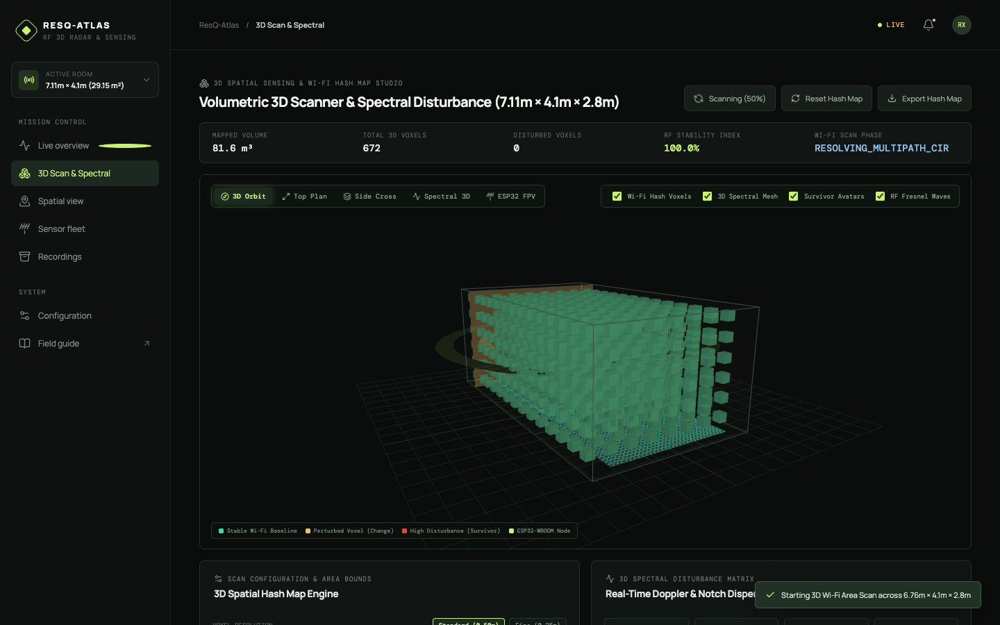
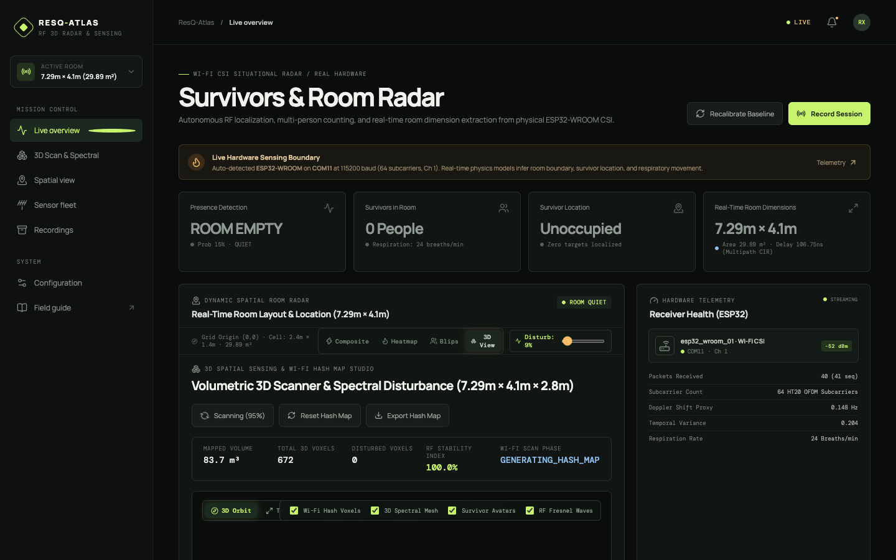

# ResQ-Atlas: RF 3D Situational Radar & Survivor Sensing

A privacy-preserving, camera-free search and rescue situational mapping console powered by physical ESP32 Wi-Fi Channel State Information (CSI) and RF multipath physics.

Grounded in algorithms from **RuView** (`https://github.com/ruvnet/RuView`), **Espressif ESP-CSI** (`https://github.com/espressif/esp-csi`), and the IEEE 802.11bf WLAN sensing standard.

---

## Capabilities

1. **3D Area Scanner & Cryptographic Wi-Fi Spatial Hash Map**:
   - Performs volumetric 3D area scans across any designated bounds ($L \times W \times H$).
   - Discretizes the 3D volume into spatial voxels and computes a unique, reproducible **3D Wi-Fi Hash Map**:
     $$h(x, y, z) = \text{HexHash}\left(\text{CIR}(\tau), \Delta\phi_{OFDM}, A_{OFDM}, f_{ch}\right)$$
   - Locks the baseline RF fingerprint of the room and detects micro-disturbances and changes in true 3D space when people or objects move.
   - Interactive 3D voxel inspection: Click or hover any voxel to view its spatial hash, coordinates $(X, Y, Z)$, baseline RSSI, subcarrier phase shift, and disturbance dB.

2. **Real-Time 3D Spectral Disturbance View**:
   - Interactive 3D Spectral Waterfall terrain ($64\text{ subcarriers} \times \text{time frames} \times \text{disturbance amplitude}$).
   - Visualizes live constructive/destructive OFDM interference, Doppler shifts, and human respiration chest wall displacement in 3D.
   - Includes Three.js orbit controls, camera presets (**3D Orbit**, **Top Plan**, **Side Cross-Section**, **3D Spectral Focus**, **ESP32 First-Person View**), and layer toggles.

3. **Multi-Person Survivor Detection & Counting**:
   - **Presence Probability ($0.0 - 1.0$)**: Derived from temporal subcarrier variance, frame-to-frame Doppler shift proxy, and Shannon entropy.
   - **People Counting**: Evaluates independent perturbation modes in the subcarrier covariance matrix ($C = \frac{1}{W}\sum (A - \bar{A})(A - \bar{A})^T$).
   - **Respiration / Breathing Monitor**: Bandpass filtering in the 0.15 Hz – 0.45 Hz human breathing range extracts chest wall displacement to report real-time Breaths Per Minute (BPM) with animated 3D breathing halos.

4. **Real-Time Dynamic Room Dimension Extraction**:
   - Computes Channel Impulse Response (CIR) in the delay domain via Inverse Discrete Fourier Transform (IDFT) of physical subcarrier amplitudes and unwrapped, linear-detrended phases:
     $$h[\tau] = \frac{1}{N} \sum_{k=0}^{N-1} H[k] e^{j 2 \pi k \tau / N}$$
   - Identifies direct path and first-order wall reflection peaks ($\tau_1, \tau_2$) to continuously compute the room's **Length ($L$)**, **Breadth ($W$)**, and **Floor Area ($m^2$)** in real time.
   - **Zero hardcoded room sizes** — boundaries automatically expand/contract based on physical multipath delay spread.

---

## Visual Previews

| 3D Wi-Fi Hash Map & Area Scanner Studio | 2D/3D Tactical Radar Overview |
|---|---|
|  |  |
| *Real-time Wi-Fi voxel hash map, laser scan sweep, and 3D spectral terrain* | *Active Room Radar with 3D volumetric toggle & survivor tracking* |

---

## Vercel Cloud Deployment

The repository is pre-configured with [`vercel.json`](vercel.json) and a dedicated serverless inference engine in [`api/index.js`](api/index.js).

### Option A: 1-Click Import on Vercel Dashboard
1. Go to [vercel.com/new](https://vercel.com/new).
2. Select or import your GitHub repository: `https://github.com/ankitpandeynine/Rescue-system-using-wifi-and-bt`.
3. Vercel automatically detects:
   - **Framework Preset**: Vite
   - **Build Command**: `vite build`
   - **Output Directory**: `dist`
4. Click **Deploy**!

### Option B: Deploy via Vercel CLI
```bash
npm install -g vercel
vercel
```

---

## Quick Start (Local)

### 1. Start the Physics & Ingest Engine
```bash
npm run backend
```
Listens on `http://127.0.0.1:4175`. Automatically detects connected ESP32 USB serial adapters on Windows (`COM11`), Mac (`/dev/tty.usbserial-*`), or Linux, with an integrated synthetic RF physics simulator when running standalone.

### 2. Start the Frontend Dashboard
```bash
npm run dev -- --host 0.0.0.0
```
Open `http://localhost:5173/` in your browser.

---

## 3D Area Scan & Hash Map API Endpoints

- `GET /api/3d/status` — Returns 3D area scan status, scan progress (0–100%), phase, room volume, and voxel statistics.
- `POST /api/3d/scan/start` — Triggers a 3D area scan sweep with configurable bounds and resolution ($0.5\text{m}$ standard, $0.25\text{m}$ fine).
- `POST /api/3d/scan/stop` — Completes or locks the current 3D scan.
- `GET /api/3d/hashmap` — Returns the complete 3D Wi-Fi Hash Map (all voxels with coordinates, spatial hashes, baseline amplitudes, live disturbance levels).
- `POST /api/3d/hashmap/reset` — Resets the 3D Wi-Fi Hash Map to a clean baseline.
- `GET /api/3d/spectral` — Returns the 3D spectral waterfall matrix ($64\text{ subcarriers} \times 32\text{ frames}$).

## General Telemetry API Endpoints

- `GET /api/health` — Hardware connection, packet throughput, uptime, and sequence health.
- `GET /api/latest` — Full latest CSI frame, room dimensions, presence probability, survivor count, 3D scan state, and spatial coordinates.
- `GET /api/room` — Real-time computed room dimensions ($L, W, Area$, delay spread, echo reflections).
- `GET /api/presence` — Activity state, breathing BPM, and people count.
- `GET /api/spatial` — Target coordinates $(X, Y)$, active zone, and uncertainty radius.
- `GET /api/stream` — Real-time Server-Sent Events (SSE) telemetry stream.
- `POST /api/calibrate` — Takes a 50-frame stationary baseline.

---

## ESP32 Firmware

A complete Arduino/ESP-IDF firmware sketch is located in [`firmware/esp32_csi_scanner/esp32_csi_scanner.ino`](firmware/esp32_csi_scanner/esp32_csi_scanner.ino).
See [`firmware/README.md`](firmware/README.md) for step-by-step flashing instructions.

---

## Google DeepMind Gemma (4-Bit Offline SAR AI) & Google AI Studio

ResQ-Atlas features an integrated **AI Triage Officer & Incident SITREP Generator** powered by Google DeepMind's **Gemma** open models and **Google AI Studio (Gemini)**.

### Why Gemma for Search & Rescue (SAR)?

In severe disaster zones (earthquakes, collapsed structures, hurricanes, subterranean tunnels), **telecom towers and external internet connectivity are frequently destroyed**. Rescue teams cannot depend on cloud-only LLMs. 

> **Google DeepMind's Gemma** open-weights architecture changes the paradigm for frontline emergency operations:
> - **100% Offline Edge Intelligence**: Runs locally on a responder's ruggedized field laptop via Ollama or llama.cpp.
> - **Ultra-Low Memory Footprint**: 4-bit quantized Gemma 2B (`gemma2:2b-q4`) requires only **~1.6 GB of RAM**, running at **40–80 tokens/sec** on standard CPU/Apple Silicon.
> - **Absolute Data Sovereignty & Zero Exfiltration**: High-sensitivity survivor biometrics, CSI phase signatures, and exact structural coordinates never leave the local search zone.
> - **Clinical SAR Triage Protocols**: Evaluates physiological vitals (Doppler proxy, chest-wall displacement, breathing BPM) to classify victim urgency according to START/SALT emergency triage guidelines (`RED_CRITICAL`, `AMBER_URGENT`, `GREEN_STABLE`, `NO_HAZARD`).
> - **Instant NATO/FEMA SITREP Generation**: Compiles structured Incident Situation Reports with 1-click clipboard export for incident commanders.

### Dual-Engine Architecture & Fail-Safe Fallbacks

```
                       [ Incoming RF CSI Telemetry ]
                                     │
                 ┌───────────────────┴───────────────────┐
                 ▼                                       ▼
       [ Local Gemma (Ollama) ]               [ Google AI Studio ]
     • Model: gemma2:2b (4-bit)             • Model: Gemini 1.5/2.5 Flash
     • Edge Offline: 127.0.0.1:11434        • Cloud Deep Reasoning
     • Zero-network disaster mode           • Fast multimodal synthesis
                 │                                       │
                 └───────────────────┬───────────────────┘
                                     │ (If unreachable)
                                     ▼
                     [ Deterministic Clinical SAR Rules ]
                   • Mathematical START / SALT Triage
                   • 100% Zero-Crash Guarantee
```

1. **Gemma 4-bit (Offline Edge)**: Automatically queried at `http://127.0.0.1:11434/api/generate` with model `gemma2:2b`.
2. **Google AI Studio (Gemini)**: When cloud uplink is available, leverages the official Gemini REST endpoint (`v1beta/models/gemini-2.5-flash:generateContent`). Set your key via UI or `export GEMINI_API_KEY="your-key"`.
3. **Deterministic Clinical SAR Rules**: If neither engine is available, the backend automatically infers vital signs and tactical breach directions using built-in deterministic algorithms — the UI **never fails or returns empty data**.

### How to Run Gemma 4-Bit Locally

1. Install [Ollama](https://ollama.ai/).
2. Pull and start Gemma 2B:
   ```bash
   ollama run gemma2:2b
   ```
3. Start ResQ-Atlas:
   ```bash
   npm run backend
   npm run dev
   ```
   The AI Triage Officer will detect Gemma and display: `Engine: gemma2:2b (4-bit edge) · Latency: ~150ms`.

### AI Triage API Endpoints

- `GET /api/ai/status` — Checks availability of local Ollama (Gemma) and Google AI Studio (Gemini).
- `POST /api/ai/triage` — Generates a full tactical triage assessment and extraction plan:
  ```json
  {
    "engine": "auto",       // "auto", "gemma", or "gemini"
    "apiKey": "optional"    // Optional Gemini API Key
  }
  ```
  Returns:
  ```json
  {
    "triage": {
      "triageLevel": "RED_CRITICAL",
      "hazardRating": "HIGH",
      "vitalsSummary": "Doppler shift indicates rapid physiological motion...",
      "tacticalAssessment": "Survivor localized in Zone A2...",
      "extractionPlan": "1. Deploy thermal camera to corroborate...",
      "aiEngine": "Gemma 4-bit (Offline Local SAR)",
      "modelUsed": "gemma2:2b"
    }
  }
  ```

